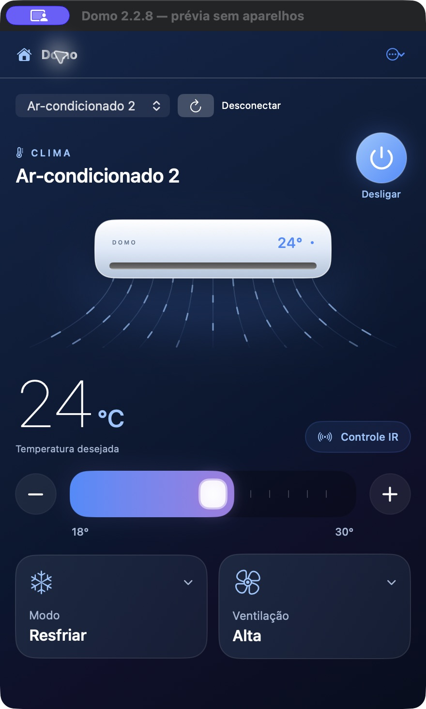
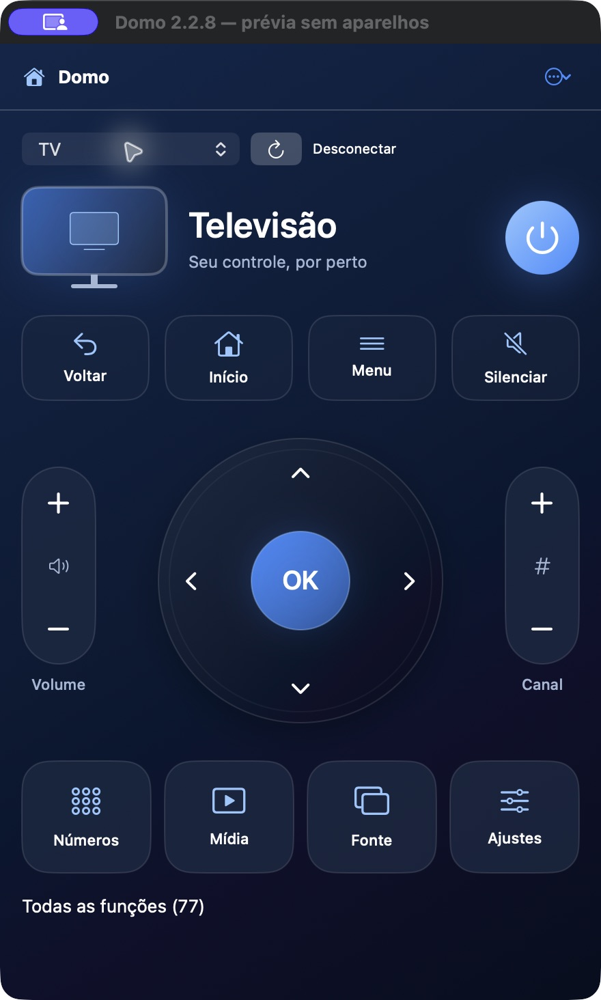

# Domo

**Sua casa na barra de menus do Mac.**

Controle a TV e o ar-condicionado sem sair do computador. O Domo é um aplicativo nativo para macOS que conecta sua conta Positivo Casa Inteligente aos controles já cadastrados no Smart Controle Universal.

[](https://github.com/barrossjoao/domo/releases/latest)
[](https://github.com/barrossjoao/domo/actions/workflows/build.yml)

[Baixar para macOS](https://github.com/barrossjoao/domo/releases/latest) · [Reportar um problema](https://github.com/barrossjoao/domo/issues) · [Contribuir](CONTRIBUTING.md)

<p align="center">
  
  
</p>

<p align="center"><sub>Prévia da interface com dados demonstrativos.</sub></p>

## Recursos

- **Acesso pela barra de menus:** abra os controles pelo ícone de casa ou use uma janela ampliada.
- **Ar-condicionado:** ajuste temperatura, modo e ventilação, com aplicação automática das alterações e um único botão de energia.
- **TV:** direcional com OK, volume, canais, teclado numérico e comandos de mídia, conforme as funções do controle cadastrado.
- **Busca de comandos:** encontre funções adicionais sem ocupar espaço no controle principal.
- **Login persistente:** acesso salvo no Chaves do macOS e recuperação de sessão ao reabrir o app.
- **Atualizações automáticas:** download e instalação de novas versões com verificação de assinatura pelo Sparkle.

Interface em SwiftUI e AppKit, com navegação por teclado e animações que respeitam a opção **Reduzir movimento** do macOS.

## Instalação

**Requisitos:** macOS 13 ou superior, Mac com Apple silicon ou Intel, conexão à internet e um Smart Controle Universal configurado no aplicativo Positivo Casa Inteligente.

1. Baixe o arquivo **Domo-…-mac-universal.zip** na [última release](https://github.com/barrossjoao/domo/releases/latest).
2. Extraia o ZIP e mova **Domo.app** para a pasta **Aplicativos**.
3. Abra o Domo e clique no ícone de casa na barra de menus.
4. Entre com sua conta **Positivo Casa Inteligente** e selecione a TV ou o ar-condicionado.

Os aparelhos precisam estar cadastrados previamente no aplicativo da Positivo. As funções disponíveis no Domo dependem dos comandos desse cadastro.

O aplicativo ainda não possui assinatura Developer ID nem notarização Apple. O macOS pode solicitar a liberação da primeira abertura.

## Atualizações

O Domo consulta novas versões a cada hora enquanto está aberto. Por padrão, baixa as atualizações verificadas e instala ao encerrar o app. Para conferir uma versão manualmente, use **Buscar atualizações…** no menu de opções ou no clique direito do ícone.

O feed e os pacotes de atualização são assinados com EdDSA. A assinatura é validada antes da extração do download. As preferências de atualização escolhidas no Sparkle são respeitadas.

## Privacidade e compatibilidade

O login e a sessão ficam no **Chaves do macOS**, sem sincronização solicitada pelo Domo. A conexão com a Positivo/Tuya usa HTTPS. A consulta de atualizações acessa as releases públicas do GitHub sem enviar suas credenciais da Positivo.

O controle depende da nuvem Positivo/Tuya e requer internet. Como o infravermelho não confirma o estado físico dos aparelhos, os ajustes exibidos representam os comandos enviados. Usar outro controle remoto pode deixar essa referência diferente do estado real.

Este é um projeto comunitário **não oficial**, sem vínculo com a Positivo ou a Tuya. Alterações no serviço externo podem afetar a compatibilidade.

## Desenvolvimento

Requer macOS 13+, Xcode ou Command Line Tools com Swift 5.9+ e Python 3.

```bash
git clone https://github.com/barrossjoao/domo.git
cd domo
make build
make verify
open dist/Domo.app
```

Abra `Package.swift` no Xcode para editar. O Swift Package Manager resolve o Sparkle; o framework acompanha o aplicativo compilado, sem instalação separada para quem usa o Domo.

Para gerar um pacote compatível com Apple silicon e Intel:

```bash
python3 scripts/build_app.py --universal
```

## Contribuição e documentação

Encontrou um problema ou tem uma sugestão? [Abra uma issue](https://github.com/barrossjoao/domo/issues). Para enviar alterações, consulte o [guia de contribuição](CONTRIBUTING.md).

- [Arquitetura](docs/ARCHITECTURE.md) — organização do código e funcionamento das integrações.
- [Publicação](docs/PUBLISHING.md) — compilação, assinatura e distribuição de versões.
- [Changelog](CHANGELOG.md) — mudanças de cada versão.

## Créditos e licenças de terceiros

A integração com a Positivo foi adaptada de [unofficial-positivo-pcuirn](https://github.com/gabriellhuver/unofficial-positivo-pcuirn), com a licença original preservada em [Licenses/positivo-integration-MIT.txt](Licenses/positivo-integration-MIT.txt).

As atualizações usam [Sparkle](https://sparkle-project.org/). Sua licença e os avisos de terceiros estão em [Licenses/Sparkle.txt](Licenses/Sparkle.txt). As duas atribuições acompanham o aplicativo distribuído.
