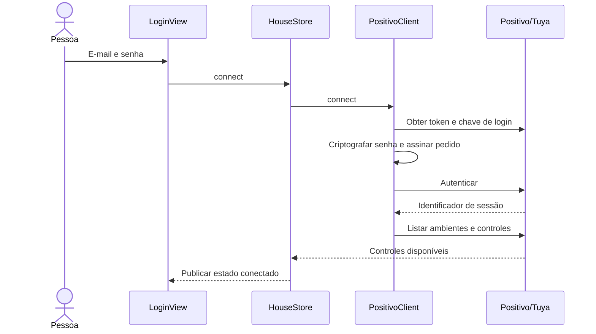

# Arquitetura

O Domo é um aplicativo macOS de um único processo. A interface, o estado dos controles e a comunicação HTTPS são implementados em Swift. Não existe serviço local em segundo plano.

## Organização

| Área | Responsabilidade | Conhece |
| --- | --- | --- |
| `App` | Ciclo de vida, janelas e estado compartilhado | Views, modelos e cliente Positivo |
| `Features` | Apresentação e eventos dos controles nativos | `HouseStore` e catálogo |
| `Models` | Dados dos controles, códigos e nomes legíveis | Foundation |
| `Services/Positivo` | Protocolo HTTPS, sessão remota, assinatura e erros | Modelos e frameworks de segurança |
| `Tests` | Exemplos de protocolo e verificações de comportamento | Aplicativo via `@testable import` |

Essas pastas representam responsabilidades dentro de um módulo. Elas não são frameworks independentes e não impõem camadas extras de chamadas.

## Ciclo de vida

`DomoApp` cria a aplicação AppKit e mantém o delegate vivo durante o loop de eventos.

`MenuBarAppDelegate` cria o ícone, o popover e a janela opcional. Ambos recebem a mesma instância de `HouseStore`. Fechar uma tela não destrói a sessão. Sair da aplicação encerra o processo, mas o acesso continua no Chaves para a próxima abertura. O delegate chama `HouseStore.restoreLogin` uma vez ao iniciar; abrir o popover ou a janela não dispara logins duplicados.

Uma segunda abertura do app revela o painel da instância existente, em vez de criar outra instância de controle.

## Estado e apresentação

`HouseStore` é um `ObservableObject` isolado no `MainActor`. Ele publica:

- estado da conexão e controles disponíveis;
- controle selecionado e comandos cadastrados;
- modo, ventilação e temperatura desejados;
- andamento e resultado das operações.

As views recebem o store por `@ObservedObject`. Cada tela mantém apenas seu estado local de apresentação, como texto de busca, expansão das funções adicionais e campos do login.

`DashboardView` compõe o cabeçalho, o conteúdo conectado ou o login e as mensagens. `DeviceControlsView` escolhe o conjunto apropriado de controles. As views de clima e TV não fazem requisições HTTP diretamente.

## Layout do painel

`DashboardView` mede a altura disponível e apresenta o painel do ar diretamente, sem `ScrollView`. Espaços, fonte da temperatura e altura da ilustração se adaptam a áreas menores. Em áreas muito baixas, somente a ilustração decorativa é ocultada. Os controles e a navegação por teclado permanecem disponíveis.

Mensagens normais de operação não ocupam mais o rodapé. Erros e avisos de persistência continuam acessíveis por um botão no cabeçalho, com o texto completo no popover e no rótulo de acessibilidade. As funções adicionais também abrem separadamente, sem aumentar a altura do painel do ar.

## Painel de clima

`ClimateControlView` apresenta as capacidades cadastradas, com cartões para modo e ventilação e um único botão de energia, com envio direto em um clique e próxima ação baseada nos envios aceitos pelo app. `HouseTheme` concentra a paleta azul; somente a barra de temperatura usa um gradiente quente.

`ClimateUnitIllustration` desenha o aparelho e as curvas do fluxo de ar em SwiftUI/Canvas. A cadência acompanha a ventilação escolhida. O relógio de fase é preservado ao alterar a velocidade, evitando saltos nos traços; a atualização visual pede até 60 quadros por segundo enquanto o painel está visível. O `TimelineView` pausa quando a ilustração deixa de estar visível ou quando **Reduzir movimento** está ativo. A animação é ilustrativa e não representa telemetria.

`ClimateTemperatureText` usa a transição nativa `.numericText` a partir do macOS 14; no macOS 13 faz uma transição de opacidade. Com **Reduzir movimento**, os dígitos mudam diretamente.

`TemperatureBar` suporta arraste, setas do teclado e ações de ajuste do VoiceOver. No macOS 14+, `.focusEffectDisabled` remove o contorno azul retangular sem retirar o foco do teclado. Durante o arraste, o cursor usa uma posição contínua; o comando enviado continua sendo uma temperatura válida. Ao soltar, uma mola curta acomoda o cursor no valor selecionado. O gradiente e o brilho ficam restritos à barra, preservando a paleta azul do painel. A seleção trabalha com índices das temperaturas disponíveis para o modo e a ventilação atuais, inclusive quando a faixa contém lacunas. `HouseStore.setTemperature` rejeita valores indisponíveis e seleções repetidas antes de usar a mesma fila de envio dos botões de incremento. Em modos sem temperatura ajustável, a barra não é exibida.

## Fluxo de login



`MobileCrypto` implementa somente as operações exigidas pelo protocolo OEM existente. Os vetores de referência permitem conferir a equivalência com a implementação anterior. MD5 e RSA bruto são exigências desse protocolo legado; a transmissão usa HTTPS.

O `PositivoClient` usa uma configuração efêmera de `URLSession`. Depois de autenticar, salva e-mail, senha, sessão e identificador do dispositivo no Chaves por `KeychainLoginStorage`. A interface limpa o campo de senha ao iniciar a conexão. Os dados de acesso não passam por `UserDefaults` nem por arquivos do projeto.

`LoginStorage` tem duas implementações: o Chaves no aplicativo e memória nos testes. `SecItemAdd`, `SecItemUpdate`, `SecItemCopyMatching` e `SecItemDelete` operam somente sobre o serviço e a conta definidos para o Domo. As consultas usam o Chaves de login padrão do macOS, com suas permissões normais, e não habilitam sincronização.

Ao iniciar, o cliente restaura a sessão e a mesma identidade do dispositivo, consultando apenas os controles. Se a nuvem recusar explicitamente a sessão, o cliente usa o login salvo para autenticar uma vez, salva a nova sessão e repete a requisição recusada uma única vez. Erros de transporte não provocam repetição automática de comandos de infravermelho. Acesso salvo não é apagado por falta de internet.

`Desconectar` desativa a restauração automática em uma preferência booleana antes de tentar apagar o item do Chaves. O cliente sempre descarta a sessão e os dados em memória. Se o macOS impedir a remoção, o painel informa a falha e a preferência impede restaurar a conta na próxima abertura. Um novo login só reativa a preferência após salvar o item com sucesso.

Se a persistência falhar, a conexão atual continua utilizável, mas o painel informa que o login não foi salvo. Se a autenticação for recusada durante a renovação, o formulário reaparece. A restauração e a renovação não reaplicam ajustes de temperatura ou energia por conta própria.

## Descoberta e catálogo

O cliente lista os ambientes da conta, identifica o controle universal e consulta seus controles infravermelhos. A resposta é convertida em `HouseRemote` e `IRCommand`.

O `HouseStore` mantém um cache dos comandos por controle somente em memória. A ação de recarregar ignora esse cache e consulta o serviço novamente.

`RemoteCatalog` traduz os nomes retornados pelo serviço e associa os botões visuais da TV às teclas originais. `ClimateChoice` interpreta combinações de modo, temperatura opcional e ventilação. As opções exibidas vêm das combinações presentes no controle, não de uma lista fixa de capacidades presumidas.

## Envio de comandos

```text
Evento de interface
    → HouseStore valida a tecla cadastrada
    → fila mantém um envio por vez
    → PositivoClient monta o payload infravermelho
    → MobileCrypto assina a requisição
    → URLSession envia por HTTPS
    → a nuvem encaminha ao controle universal
```

Alterar modo, ventilação ou temperatura dispara o envio automaticamente. Se houver outra alteração durante um envio, a seleção mais recente fica pendente para ser enviada em seguida. Os botões da TV aguardam o envio atual terminar.

Carregar uma tela, selecionar outro controle ou consultar seus comandos não executa ações físicas. O estado exibido representa a seleção desejada; ele não é uma medição do estado atual da TV ou do ar-condicionado.

## Limites da integração

O serviço externo retorna JSON com formatos próprios do aplicativo OEM. A conversão e a validação desses dados ficam no `PositivoClient`; os erros apresentados ao usuário são definidos por `PositivoError`.

O protocolo não oficial pode mudar. Falhas de rede e de autenticação são mostradas no painel. A integração não confirma que o aparelho recebeu o sinal infravermelho, mesmo quando a nuvem aceitou o pedido.

## Compilação e pacote

`Package.swift` declara o executável e o target XCTest, sem dependências externas. O Swift Package Manager descobre os arquivos em `Sources` e `Tests`, eliminando listas manuais de fontes no empacotador.

`scripts/build_app.py` compila em release, copia o binário, os metadados de `Resources/Info.plist` e as licenças para um pacote temporário. A assinatura local é verificada antes da substituição do aplicativo existente. Uma falha ao substituir o pacote restaura a versão anterior.

`scripts/verify_app.py` faz inspeção estática de metadados, assinatura, bibliotecas vinculadas e arquivos embarcados. Ele não executa o aplicativo nem acessa a nuvem. As saídas geradas ficam em `dist`; o cache do SwiftPM fica em `.build`. Ambos são ignorados pelo Git.

## Testes

| Conjunto | Cobertura prevista |
| --- | --- |
| `MobileCryptoTests` | Hash móvel, assinatura, RSA e interpretação de números/pulsos |
| `PositivoClientTests` | Login, descoberta, consultas sem envio, payload, logout e erros |
| `SavedLoginTests` | Restauração sem login novo, identidade estável, renovação de sessão, rede indisponível e logout com falha de remoção |
| `RemoteCatalogTests` | Associação dos botões e interpretação dos modos do ar |
| `HouseStoreTests` | Estado conectado, ajuste automático, troca de controle e desconexão |

`MemoryLoginStorage` mantém os acessos sintéticos somente em memória; os testes não consultam nem alteram o Chaves real. `MockPositivoProtocol` intercepta a sessão HTTP exclusivamente nos testes. As respostas e as credenciais usadas nesses cenários são sintéticas. Os testes não acionam equipamentos reais.

## Onde alterar cada comportamento

- **Layout e apresentação:** a view correspondente em `Features`.
- **Eventos, seleções e fila de comandos:** `App/HouseStore.swift`.
- **Tradução ou associação de teclas:** `Models/RemoteCatalog.swift`.
- **Formato do protocolo ou requisições:** `Services/Positivo/PositivoClient.swift`.
- **Assinatura ou criptografia:** `Services/Positivo/MobileCrypto.swift`, mantendo os vetores de referência.
- **Nome, versão e identidade do app:** `Resources/Info.plist`.
- **Empacotamento e distribuição local:** `scripts/build_app.py`.

## Controle da TV

`TVRemoteView` usa o catálogo existente para apresentar apenas teclas disponíveis. O direcional, os controles relativos de volume/canal e os atalhos principais ficam no painel sem rolagem. Números e mídia usam popovers nativos; os comandos não mapeados continuam na busca de funções adicionais. `RemoteButtonStyle`, em `HouseTheme`, compartilha feedback de hover e pressão com o ar e respeita Reduzir movimento. Nenhum estado físico de volume, canal ou energia é inferido.

## Edição de texto no app de menu bar

O bootstrap AppKit instala um menu principal com as ações padrão Recortar, Copiar, Colar e Selecionar tudo. O macOS encaminha os atalhos pela cadeia de responders ao campo em foco, tanto no popover quanto na janela. O login continua usando `TextField` e `SecureField` nativos; a edição mantém as proteções do campo de senha, sem ler o clipboard por conta própria.

## Login e ciclo de vida do painel

`LoginView` usa a paleta `HouseTheme` e mantém `TextField`/`SecureField` nativos, com rótulos, foco, colagem e envio pelo teclado. A validação impede submissões vazias; durante a conexão, os campos são desativados e o botão mostra progresso.

O popover só abre por ações no ícone da barra de menus. Inicialização e detecção de outra instância não revelam mais o painel. Além do comportamento transitório nativo, notificações de troca de Space, ativação de outro app, perda de ativação e mudança na configuração de monitores fecham o popover. Um monitor global de cliques existe somente enquanto ele está aberto e é removido no fechamento; não registra coordenadas nem conteúdo. A altura é recalculada pela tela do botão ao abrir. A janela ampliada continua sendo uma janela comum, aberta explicitamente pelo menu.

## Alternância de energia do ar

`HouseStore.climatePowerCommand` escolhe um toggle real, quando cadastrado, ou alterna os comandos explícitos Ligar/Desligar. A referência em memória é individual por controle e só muda depois de `PositivoClient.send` concluir sem erro. Ajustes de clima aceitos representam a intenção de ligar. Falhas preservam a próxima ação; seleção de outro controle não apaga a referência, enquanto desconexão, perda da sessão ou nova conexão a limpam. Sem histórico, a primeira ação é Ligar. A referência não confirma o estado físico nem acompanha comandos enviados por outros controles.

## Nome e compatibilidade

O nome de produto, módulo Swift, executável e pacote é `Domo`; o projeto fica em `~/Documents/domo`. O identificador de bundle `br.automatizehouse.mac` e o serviço do Chaves `br.automatizehouse.mac.positivo.login` permanecem estáveis para preservar a identidade do aplicativo, o acesso salvo e as preferências existentes. Esses identificadores internos não são nomes de apresentação. Nenhum login é copiado para arquivos ou para o repositório.
